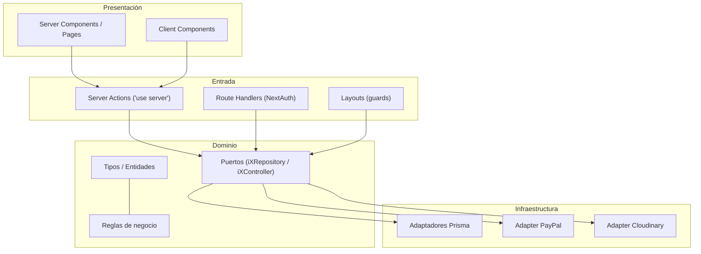
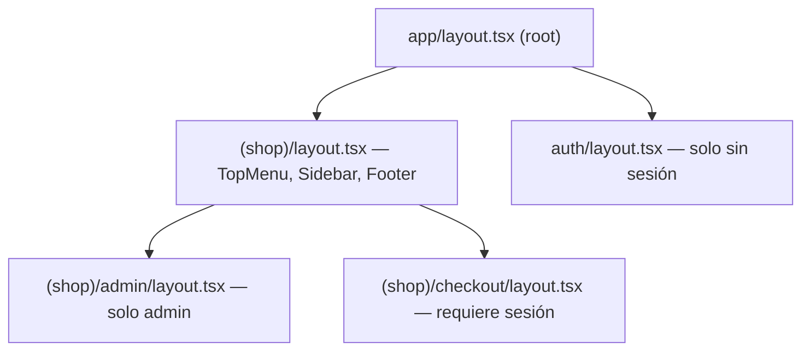
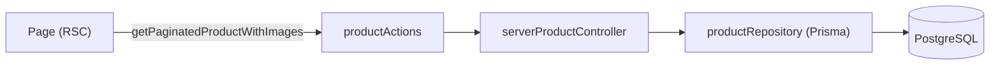
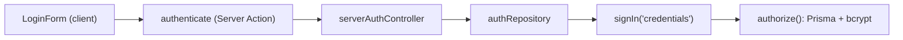

# Arquitectura — Apex Padel Store

> Documento de arquitectura de **next-shop-apex-padel**. Describe cómo se organiza el sistema, las capas, los patrones aplicados y las decisiones de diseño relevantes. Se alinea con las convenciones definidas en [`AGENTS.md`](../AGENTS.md) y con la [Documentación Técnica](./DOCUMENTACION-TECNICA.md).

---

## Tabla de contenidos

1. [Visión general](#1-visión-general)
2. [Principios arquitectónicos](#2-principios-arquitectónicos)
3. [Arquitectura hexagonal](#3-arquitectura-hexagonal)
4. [Capas y responsabilidades](#4-capas-y-responsabilidades)
5. [Estructura del repositorio](#5-estructura-del-repositorio)
6. [Anatomía de un módulo](#6-anatomía-de-un-módulo)
7. [Puertos y adaptadores](#7-puertos-y-adaptadores)
8. [Adaptadores de entrada: Server Actions](#8-adaptadores-de-entrada-server-actions)
9. [Capa de presentación (Next.js App Router)](#9-capa-de-presentación-nextjs-app-router)
10. [Estado del cliente](#10-estado-del-cliente)
11. [Integraciones externas](#11-integraciones-externas)
12. [Modelo de datos y acceso](#12-modelo-de-datos-y-acceso)
13. [Flujos principales](#13-flujos-principales)
14. [Decisiones de diseño y trade-offs](#14-decisiones-de-diseño-y-trade-offs)
15. [Guía para extender el proyecto](#15-guía-para-extender-el-proyecto)
16. [Deuda técnica y riesgos](#16-deuda-técnica-y-riesgos)

---

## 1. Visión general

El proyecto es una aplicación **Next.js full-stack** (React 19, App Router) que sirve UI y ejecuta la lógica de servidor mediante **Server Components**, **Server Actions** y **route handlers** de NextAuth. La lógica de negocio no vive en las páginas ni en los componentes, sino en **módulos de dominio** que se comunican con el exterior a través de **puertos** e **implementaciones (adaptadores)**.

El estilo arquitectónico es una **aproximación pragmática a la arquitectura hexagonal (ports & adapters)**:

- El **dominio** define tipos, reglas y contratos (puertos).
- La **infraestructura** provee las implementaciones concretas (adaptadores Prisma, Cloudinary, PayPal).
- Los **controllers** actúan como _adaptadores de entrada_: traducen la petición del framework al dominio y delegan.
- La **UI** (React/Next.js) consume esos adaptadores de entrada, a través de Server Actions o llamadas directas en el servidor.



---

## 2. Principios arquitectónicos

1. **Núcleo independiente del framework.** El dominio no importa componentes de UI ni utilidades de Next.js; solo depende de tipos y reglas.
2. **Inversión de dependencias.** Los controllers dependen de **interfaces** (`iProductRepository`, `iOrderRepository`, …), no de implementaciones concretas.
3. **Adaptadores de entrada delgados.** Los controllers extraen datos, aplican permisos y delegan; no contienen reglas de negocio complejas.
4. **Organización por dominio.** Cada capacidad (productos, pedidos, pagos, usuarios…) es un módulo cohesionado.
5. **Simplicidad sobre complejidad.** No hay una capa de aplicación separada; la orquestación se resuelve en controllers o en servicios de dominio.
6. **Presentación reutilizable.** Los componentes de UI se agrupan en `ui/` de cada módulo y en un módulo `shared`.

---

## 3. Arquitectura hexagonal

La arquitectura hexagonal de este proyecto se materializa en cuatro capas por módulo:

```
modules/<dominio>/
├── domain/      # Entidades, tipos, reglas y contratos del núcleo
├── infra/       # Adaptadores: puertos (interfaces) + implementaciones
│   └── dto/     # (opcional) DTOs de la infraestructura
├── controller/  # Adaptador de entrada: interfaz + factory + server actions
└── ui/          # Componentes y utilidades de presentación
```

### Criterio de ubicación

- **Puertos** (`iXRepository`): contratos definidos en `infra` (o `domain`, según el módulo) junto al consumo que los da sentido.
- **Implementaciones** (`xRepository`): en `infra`, específicas del motor técnico (Prisma, PayPal, Cloudinary).
- **DTOs:** en `infra/dto` cuando describen la forma de los datos de infraestructura (p. ej. `CategoryDto`, `CountryDto`); el dominio expone _builders_ (`buildCategory`, `buildCountries`) que transforman DTO → dominio.
- **Interfaces de controller** (`iXController`): junto al controller que las implementa; compartidas cuando aplica.

---

## 4. Capas y responsabilidades

| Capa                          | Ubicación               | Responsabilidad                                                  | No debe…                                           |
| ----------------------------- | ----------------------- | ---------------------------------------------------------------- | -------------------------------------------------- |
| Presentación (UI)             | `app/`, `modules/**/ui` | Render, interacción, formularios, estado local                   | Contener reglas de negocio                         |
| Entrada (controllers/actions) | `modules/**/controller` | Traducir solicitudes, validar permisos, invalidar caché, delegar | Implementar lógica de negocio o de infraestructura |
| Dominio                       | `modules/**/domain`     | Entidades, tipos, reglas, cálculos, contratos de permisos        | Depender de Next.js, Prisma o proveedores          |
| Infraestructura               | `modules/**/infra`      | Persistencia, clientes externos, mapeo DTO ↔ dominio             | Conocer detalles de UI                             |

### Ejemplos concretos

- **Regla de negocio en dominio:** `calculateOrderTotals` y `countItemsInOrder` en `order/domain/Order.ts`; `canManageUsers` en `user/domain/authorization.ts`.
- **Puerto:** `iOrderRepository` en `order/infra/iOrderRepository.ts`.
- **Adaptador:** `orderRepository` (Prisma, con transacción) en `order/infra/orderRepository.ts`.
- **Adaptador de entrada:** `serverOrderController` + `orderActions` en `order/controller/`.

---

## 5. Estructura del repositorio

```
next-shop-apex-padel/
├── prisma/
│   ├── schema.prisma            # Modelo de datos
│   └── migrations/              # Migraciones versionadas
├── public/                      # Assets estáticos (imágenes de seed, etc.)
├── src/
│   ├── app/                     # App Router (rutas, layouts, route handlers)
│   │   ├── (shop)/              # Grupo público + admin
│   │   └── auth/                # Grupo de autenticación
│   ├── generated/prisma/        # Cliente Prisma generado (gitignored)
│   ├── modules/                 # Módulos de dominio (arquitectura hexagonal)
│   │   ├── address/
│   │   ├── auth/
│   │   ├── category/
│   │   ├── config/              # Fuentes y configuración visual
│   │   ├── country/
│   │   ├── order/
│   │   ├── payments/
│   │   ├── products/
│   │   ├── seed/                # Scripts de datos iniciales
│   │   ├── shared/              # Prisma client, componentes y utils comunes
│   │   ├── store/               # Estado global (Zustand)
│   │   └── user/
│   ├── auth.config.ts           # Configuración de NextAuth
│   └── proxy.ts                 # Middleware de NextAuth (proxy)
├── docs/                        # Documentación
├── docker-compose.yml           # PostgreSQL local
├── next.config.ts
├── prisma.config.ts
├── eslint.config.mjs
└── .prettierrc
```

### Módulos existentes

| Módulo     | Rol                                                                 |
| ---------- | ------------------------------------------------------------------- |
| `products` | Catálogo, paginación, CRUD, imágenes (Cloudinary)                   |
| `category` | Categorías de producto (puerto + adaptador, patrón con DTO/builder) |
| `country`  | Países para direcciones (puerto + adaptador, DTO/builder)           |
| `order`    | Pedidos: creación transaccional, totales, listado y detalle         |
| `payments` | Integración con PayPal (orden, captura y verificación)              |
| `address`  | Dirección por defecto del usuario (persistencia y store cliente)    |
| `auth`     | Login, logout y registro (wrapper sobre NextAuth)                   |
| `user`     | Usuarios y gestión de roles                                         |
| `store`    | Estado global (cart, address, ui) — capa de presentación            |
| `shared`   | Cliente Prisma, componentes UI base y utilidades comunes            |
| `config`   | Fuentes (Manrope/Inter)                                             |
| `seed`     | Datos iniciales para desarrollo                                     |

---

## 6. Anatomía de un módulo

Ejemplo canónico (`products`), representativo del patrón común:

```
products/
├── domain/
│   ├── Product.ts              # Tipos: Product, CartProduct, ProductWithImages, PaginationOptions…
│   └── index.ts                # Barrel
├── infra/
│   ├── iProductRepository.ts   # PUERTO (contrato)
│   ├── productRepository.ts    # ADAPTADOR (Prisma + Cloudinary)
│   └── index.ts
├── controller/
│   ├── serverProductController.ts  # Interfaz + factory + validación Zod + revalidatePath
│   ├── productActions.ts           # Server Actions ('use server')
│   └── index.ts
└── ui/
    └── components/
        ├── index.ts
        ├── product/…            # AddToCart, ProductForm, ProductImage, selectores, slideshows
        └── products/…           # ProductGrid, ProductGridItem
```

### Patrón de factory + inyección de dependencias

Los controllers se construyen mediante una **factoría que recibe el puerto** y devuelven una implementación del contrato:

```ts
const ProductController = (repo: iProductRepository): iProductController => ({ ... })

export const serverProductController = (): iProductController => {
  return ProductController(productRepository)
}
```

Esto desacopla el controller de la implementación concreta y facilita el testing (basta inyectar un repositorio falso). El mismo patrón aparece en `AddressController`, `ServerCountryController`, `categoryController`, `OrderController`, `PaymentController`, `AuthController` y `UserController`.

---

## 7. Puertos y adaptadores

| Dominio  | Puerto (contrato)     | Adaptador(es)        | Tecnología             |
| -------- | --------------------- | -------------------- | ---------------------- |
| products | `iProductRepository`  | `productRepository`  | Prisma + Cloudinary    |
| order    | `iOrderRepository`    | `orderRepository`    | Prisma (transacciones) |
| payments | `iPaymentRepository`  | `paymentRepository`  | Prisma + REST PayPal   |
| address  | `iAddressRepository`  | `addressRepository`  | Prisma                 |
| country  | `iCountryRepository`  | `countryRepository`  | Prisma + builder       |
| category | `iCategoryRepository` | `categoryRepository` | Prisma + builder       |
| user     | `iUserRepository`     | `userRepository`     | Prisma                 |
| auth     | `iAuthRepository`     | `authRepository`     | NextAuth + bcryptjs    |

### Convención de nombres

- Interfaces con prefijo `i` (`iProductRepository`, `iProductController`).
- Implementaciones en camelCase (`productRepository`).
- Factorías de controller: `server<Dominio>Controller()` (o `implement<...>Controller()` en address/country/category).

---

## 8. Adaptadores de entrada: Server Actions

La frontera de entrada para las mutaciones es el conjunto de **Server Actions** (`'use server'`). Su rol es exponer una función segura al cliente que, internamente, delega en el controller:

```ts
'use server'
import { serverProductController } from './serverProductController'

export const createUpdateProduct = async (formData: FormData) => serverProductController().createUpdateProduct(formData)
```

Responsabilidades típicas del controller server-side:

1. **Autenticación/autorización** con `auth()` (p. ej. verificar admin o que el usuario sea dueño de la orden).
2. **Validación** de entrada (Zod en `createUpdateProduct`).
3. **Delegación** al repositorio.
4. **Invalidación de caché** con `revalidatePath(...)` tras mutaciones.

Ejemplos de guards observados:

- `serverOrderController.getOrderById`: impide que un usuario no-admin acceda al pedido de otro.
- `serverUserController`: exige `canManageUsers(session?.user.role)`.
- `serverPaymentController`: `revalidatePath` tras verificar el pago.

---

## 9. Capa de presentación (Next.js App Router)

### Route groups y layouts



- **`(shop)`**: chrome de tienda (menú, sidebar, footer).
- **`auth`**: redirige a `/` si ya hay sesión.
- **`(shop)/admin`**: redirige si el rol no es `admin`.
- **`(shop)/checkout`**: exige sesión; si no la hay, redirige a `/auth/login?redirectTo=/checkout/address`.

> Excepción contradictoria: el patrón de guards se implementa tanto en **layouts** (navegación) como en **controllers** (datos). Esta doble red es intencional (defensa en profundidad): nunca se confía únicamente en la UI.

### Server vs Client Components

- **Server Components (por defecto):** páginas que leen datos del servidor (home, catálogo, detalle, admin, pedidos).
- **Client Components (`'use client'`):** interactivos o con estado/persistencia (`TopMenu`, `Sidebar`, `Pagination`, `ProductsInCart`, `OrderSummary`, `AddToCart`, `ProductForm`, `AddressForm`, `RegisterForm`, `LoginForm`, `PayPalButton`, `PlaceOrder`, `UsersTable`, `StockLabel`).

### Estrategias de datos

- **ISR:** `revalidate` por página (60 s catálogo, ~7 días producto).
- **Invalidación on-demand:** `revalidatePath` en controllers.
- **Páginas dinámicas:** admin y pedidos con `revalidate = 0`.

---

## 10. Estado del cliente

Zustand gestiona el estado efímero/persistente del navegador:

| Store             | Persistencia | Uso                                                     |
| ----------------- | ------------ | ------------------------------------------------------- |
| `useCartStore`    | localStorage | Carrito (ítems por `id + size`, totales con `TAX_RATE`) |
| `useAddressStore` | localStorage | Dirección capturada en el checkout                      |
| `useUIStore`      | —            | Apertura/cierre del sidebar                             |

Consideraciones de diseño:

- La **tasa de impuestos es única fuente de verdad** en el dominio (`TAX_RATE`), reutilizada por el store y por `calculateOrderTotals` del servidor.
- Se usa `useSyncExternalStore` para resolver hidratación de estado persistido sin _mismatch_.

---

## 11. Integraciones externas

| Integración | Punto de contacto                             | Configuración                                         |
| ----------- | --------------------------------------------- | ----------------------------------------------------- |
| PostgreSQL  | `shared/lib/prisma.ts` (adaptador `PrismaPg`) | `DATABASE_URL` + docker-compose                       |
| Prisma      | `prisma/schema.prisma`, `prisma.config.ts`    | `output` → `src/generated/prisma`                     |
| Cloudinary  | `products/infra/productRepository.ts`         | `CLOUDINARY_URL`                                      |
| PayPal REST | `payments/infra/paymentRepository.ts`         | `NEXT_PUBLIC_PAYPAL_CLIENT_ID`, `PAYPAL_SECRET`, URLs |
| PayPal JS   | `payments/ui/providers/Provider.tsx`          | `NEXT_PUBLIC_PAYPAL_CLIENT_ID`                        |
| NextAuth    | `auth.config.ts`, `proxy.ts`                  | `AUTH_SECRET`                                         |

Todas las integraciones están **aisladas en `infra`**, de modo que el dominio y la UI no conocen los SDK ni las APIs concretas.

---

## 12. Modelo de datos y acceso

- El **esquema Prisma** es la definición autoritativa del modelo (ver Documentación Técnica §7).
- El **cliente Prisma** es un singleton en `shared/lib/prisma.ts`, construido con el adaptador `PrismaPg`.
- El **acceso a datos** se encapsula siempre en los repositorios de cada módulo; ninguna página consulta Prisma directamente **excepto** `auth.config.ts` (búsqueda de usuario en `authorize`) y el módulo de seed. Esto es una concesión práctica por tratarse de infraestructura transversal.

### Transacciones

Solo el flujo crítico de creación de pedido usa `prisma.$transaction`: descontar stock, crear `Order`, `OrderItem` y `OrderAddress` de forma atómica, revirtiendo ante cualquier error (p. ej. stock insuficiente).

---

## 13. Flujos principales

### 13.1 Catálogo y paginación



`take = 12` por página; `totalPages = ceil(total / take)`. La home y el catálogo por género comparten el flujo.

### 13.2 Autenticación



### 13.3 Alta/edición de producto (admin)

1. `ProductForm` (client) construye un `FormData` (campos + imágenes).
2. `createUpdateProduct` (Server Action) → `serverProductController` valida con Zod y delega.
3. `productRepository` ejecuta transacción: upsert de producto + subida de imágenes a Cloudinary.
4. El controller invoca `revalidatePath` sobre admin y tienda.

### 13.4 Pago

Descrito en detalle en la Documentación Técnica §11–§12. El `transactionId` se persiste antes de la captura y la orden se marca como pagada tras verificar `status === 'COMPLETED'` en PayPal.

---

## 14. Decisiones de diseño y trade-offs

| Decisión                                         | Motivo                                           | Trade-off / Nota                                    |
| ------------------------------------------------ | ------------------------------------------------ | --------------------------------------------------- |
| Hexagonal sin capa de aplicación explícita       | Simplicidad; la orquestación cabe en controllers | Los controllers hacen guard + delegación + caché    |
| Puertos en `infra` en vez de `domain` (algunos)  | Cohesión con el adaptador que los implementa     | Menor pureza académica, mayor pragmatismo           |
| DTO + builder en country/category                | Aislar la forma del ORM del dominio              | No todos los módulos lo usan (inconsistencia menor) |
| NextAuth con JWT (sin adaptador de sesión en BD) | Evita tabla de sesiones; integración simple      | El `role` se propaga en el token                    |
| Guards en layout **y** controller                | Defensa en profundidad                           | Duplicación parcial de responsabilidades            |
| `revalidatePath` en controllers                  | Mantener coherencia de caché tras mutaciones     | Acopla el controller al router de Next.js           |
| Estado de carrito en cliente (Zustand persist)   | UX fluida sin llamadas de red                    | El carrito no existe en servidor hasta `placeOrder` |
| Prisma en `auth.config.ts` y seed                | Infraestructura transversal (auth/seed)          | Única excepción a “solo repositorios tocan la BD”   |
| React Compiler activado                          | Optimización automática de renders               | Requiere compatibilidad del ecosistema              |

---

## 15. Guía para extender el proyecto

### Añadir una nueva capacidad (dominio)

1. Crear `src/modules/<dominio>/` con `domain/`, `infra/`, `controller/` y (si aplica) `ui/`.
2. Definir tipos y reglas en `domain/` (sin dependencias de framework/ORM).
3. Declarar el **puerto** `i<Dominio>Repository` en `infra/`.
4. Implementar el **adaptador** `<dominio>Repository` (Prisma u otro).
5. Crear el controller con factoría `server<Dominio>Controller()` que reciba el puerto.
6. Exponer **Server Actions** en `<dominio>Actions.ts` (`'use server'`).
7. Exportar barrels (`index.ts`) en cada carpeta para imports limpios.

### Añadir una página

1. Crear el archivo en `src/app/...` siguiendo el route group correspondiente.
2. Consumir datos vía Server Actions del módulo (no acceder a Prisma directamente).
3. Añadir `revalidate` si la página es cacheable.
4. Añadir el guard de rol/sesión en el layout más cercano si aplica.

### Cambiar el modelo de datos

1. Editar `prisma/schema.prisma`.
2. `npx prisma migrate dev -n <nombre>`.
3. Actualizar tipos de dominio y adaptadores afectados.
4. Verificar `revalidatePath` en controllers si cambia la forma de los datos cacheados.

---

## 16. Deuda técnica y riesgos

- **Redirección inconsistente:** `(shop)/admin/layout.tsx` redirige a `/login` (inexistente); debería ser `/auth/login`.
- **Uso de etiqueta `` de `next/image`:** las imágenes de producto/subida mezclan rutas relativas de `public` con URLs absolutas de Cloudinary; requiere disciplina en `ProductImage`.
- **Cloudinary en tiempo de build/URLs:** `generateMetadata` asume `images[1]` y prefijo `/products/`; conviene validar para URL absolutas.
- **Acceso a Prisma fuera de repositorios:** en `auth.config.ts` y `seed` (aceptado, pero a documentar).
- **Errores silenciados:** varios adaptadores capturan excepciones y devuelven mensajes genéricos; el logging se apoya en `console.log`.
- **Inconsistencia de patrones:** algunos módulos usan DTO/builder (`country`, `category`) y otros no; unificar reduce fricción cognitiva.
- **Autorización a nivel de datos:** se apoya en controllers; añadir pruebas que cubran roles y acceso a recursos ajenos (p. ej. pedidos de otros usuarios) reforzaría la seguridad.

---

### Referencias cruzadas

- Detalles funcionales, variables de entorno y comandos: [`DOCUMENTACION-TECNICA.md`](./DOCUMENTACION-TECNICA.md)
- Inventario de páginas: [`PAGES.md`](./PAGES.md)
- Convenciones de trabajo: [`AGENTS.md`](../AGENTS.md)
- Guía de inicio rápido: [`README.md`](../README.md)
